# Assignment 1 – User Authentication using Biometric Features

**Course:** Advanced Biometric Systems and Security (AI461)
**Instructor:** Praveen Kumar Chandaliya, DoAI, SVNIT

---

## What this assignment is about

We were given a dataset of 100 users, each with 10 biometric samples (5 taken at
enrollment and 5 taken six months later), and each sample represented as a
144-dimensional feature vector. The goal was to build a simple verification
pipeline: use the first 5 samples per user to create an enrollment template,
then match the remaining 5 samples against all 100 templates and see how well
the system separates genuine users from impostors.

We had to do this using **two different matchers** — Euclidean distance and
cosine similarity — and report:

- A. Genuine score distribution
- B. Impostor score distribution
- C. FAR plot
- D. FRR plot
- E. ROC curve
- F. EER and Decidability Index (d′)

...and finally say which matcher works better.

---

## My approach

1. Loaded `biomet_data.csv`, dropped the extra empty column, and reshaped the
   data into `(100 users, 10 samples, 144 features)`.
2. Split each user's 10 samples into enrollment (`[0:5]`) and test (`[5:10]`).
3. Built one **template per user** by averaging their 5 enrollment vectors.
4. For every test sample:
   - Compared it to its **own** user's template → genuine score
     (100 × 5 = **500 genuine scores**)
   - Compared it to every **other** user's template → impostor score
     (500 × 99 = **49,500 impostor scores**)
5. Did this twice — once with Euclidean distance, once with cosine similarity.
6. Swept a range of thresholds to compute FAR/FRR curves and EER for both
   matchers.
7. Used `sklearn.metrics.roc_curve` / `auc` to get ROC curves and AUC.
8. Computed the decidability index d′ from the genuine/impostor means and
   standard deviations for both matchers.

---

## A. Genuine Distribution

| Euclidean | Cosine |
|---|---|
| 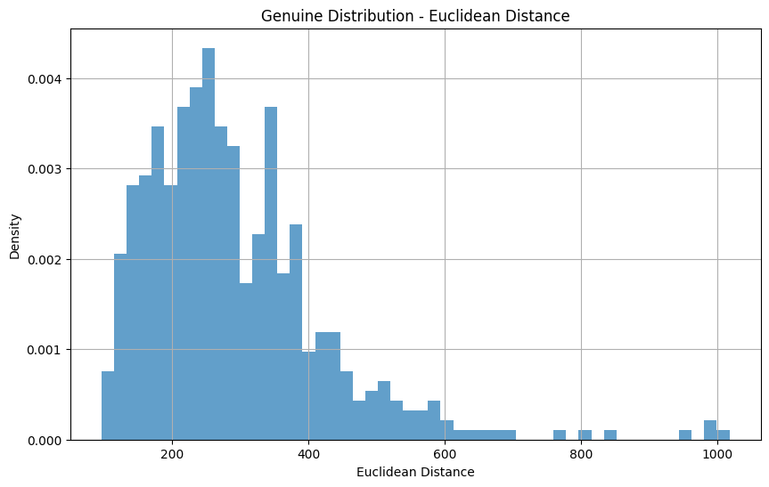 | 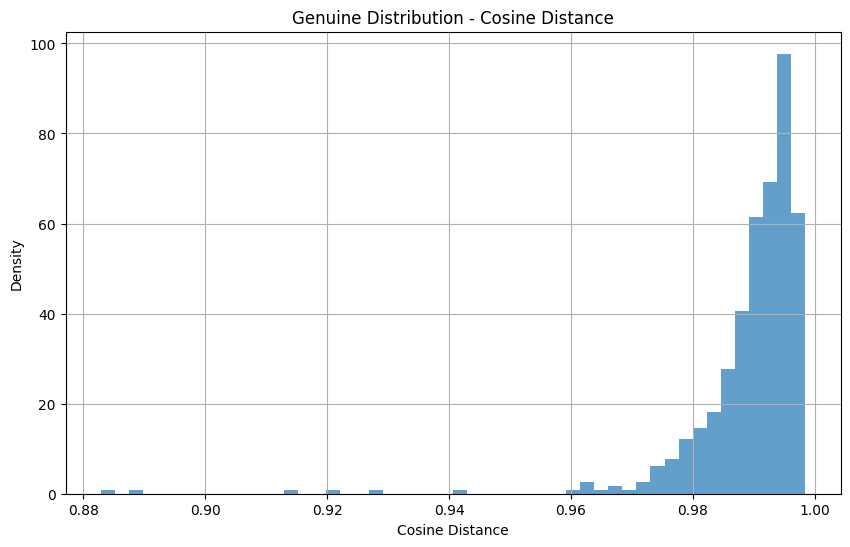 |

For Euclidean distance, most genuine scores fall between ~150–400, meaning a
correct user's test sample stays fairly close to their own template. For
cosine similarity, genuine scores are packed tightly near 1.0 (mostly
0.98–1.00), which makes sense — a matching user's feature vector should point
in almost the same direction as their template.

## B. Impostor Distribution

| Euclidean | Cosine |
|---|---|
| 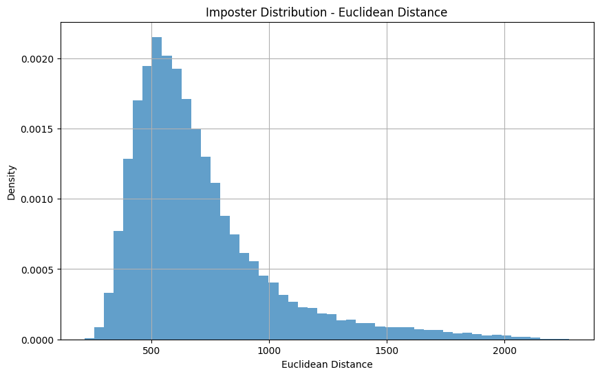 | 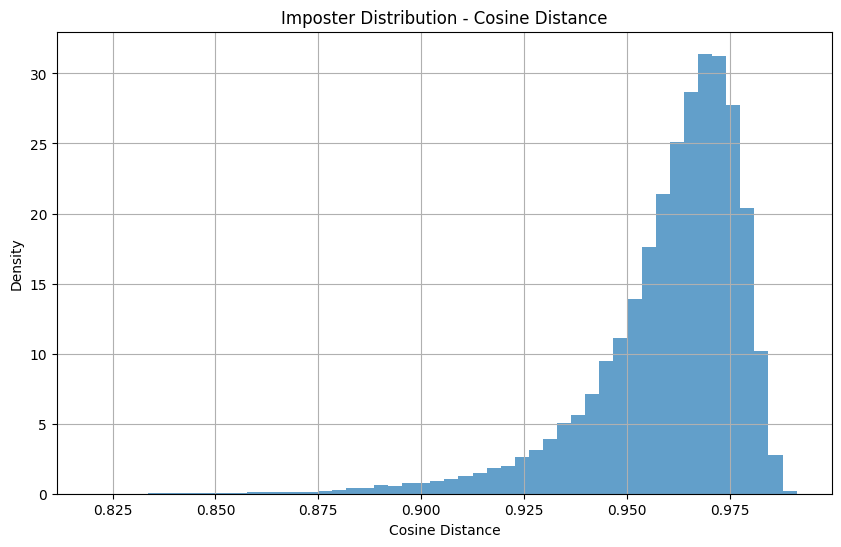 |

Impostor Euclidean distances are centered much further out (~500–800), and
impostor cosine similarities cluster lower (~0.93–0.98) than the genuine ones,
though there's some overlap near the edges.

**Genuine vs. Impostor overlay** — this is really the plot that shows how
separable the two classes are:

| Euclidean | Cosine |
|---|---|
|  | 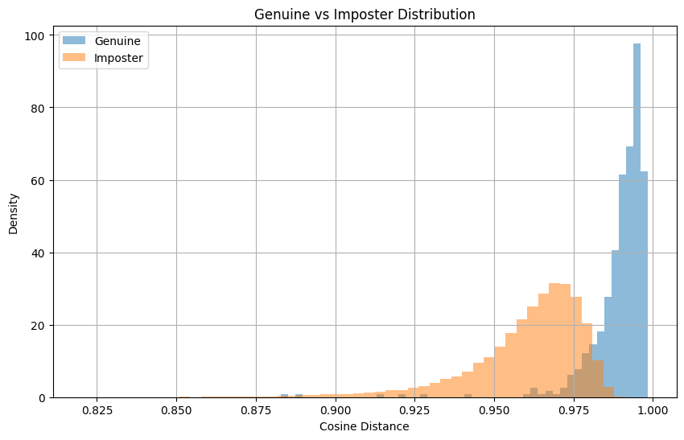 |

Both show decent separation, but there's visible overlap in both cases — this
overlap is exactly what causes false accepts/rejects at certain thresholds.

## C & D. FAR / FRR Plots

**Euclidean:**

| FAR | FRR | Both |
|---|---|---|
| 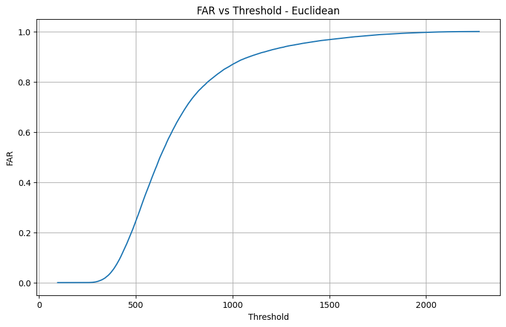 | 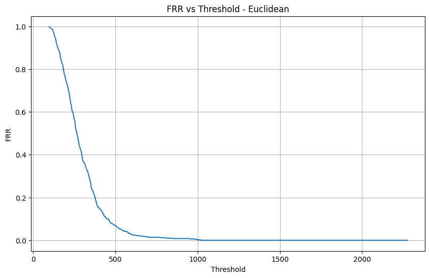 | 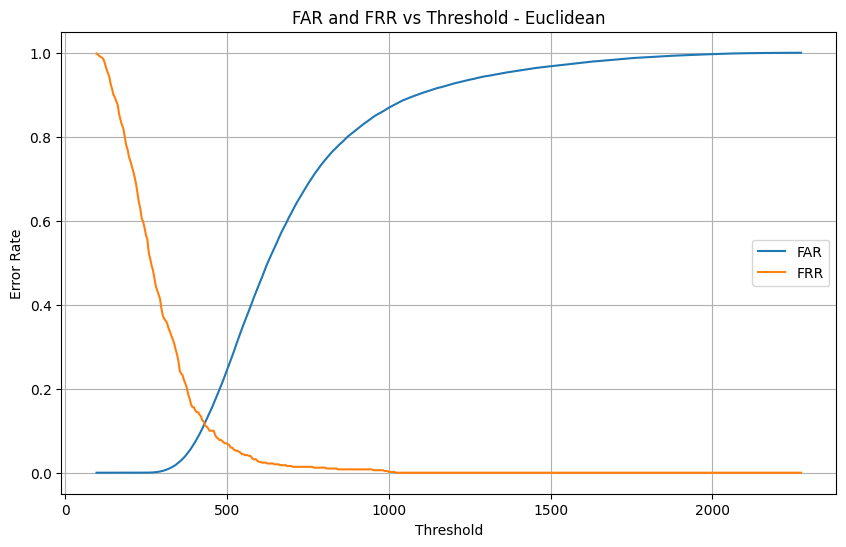 |

**Cosine:**

| FAR | FRR | Both |
|---|---|---|
| 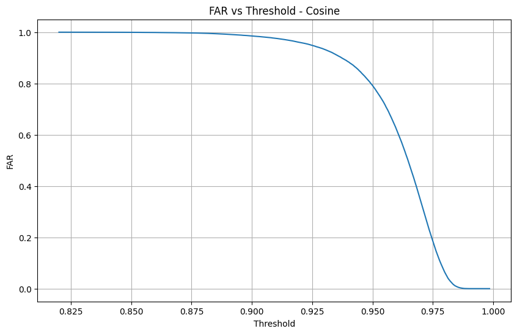 | 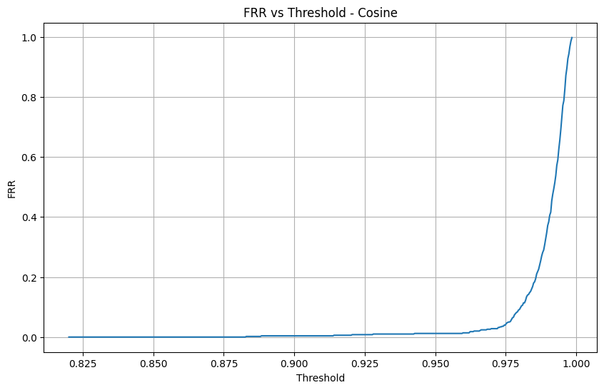 | 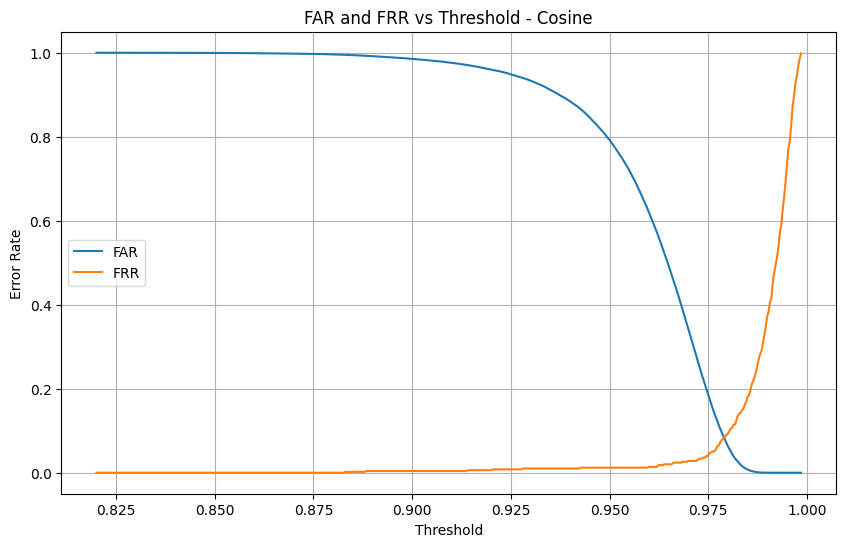 |

As expected, FAR increases and FRR decreases as the threshold gets more
"lenient" — the crossover point of these two curves is where the EER lives.

## E. ROC Curve

| Euclidean | Cosine |
|---|---|
| 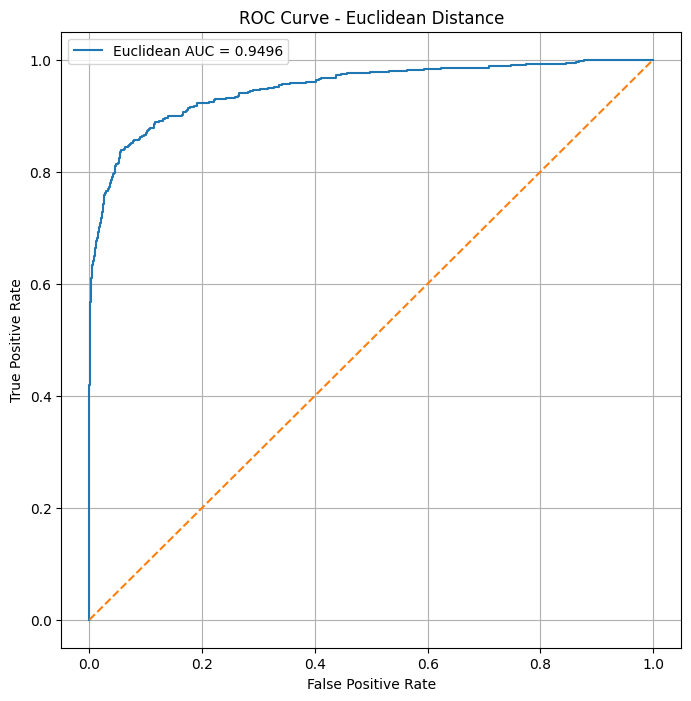 | 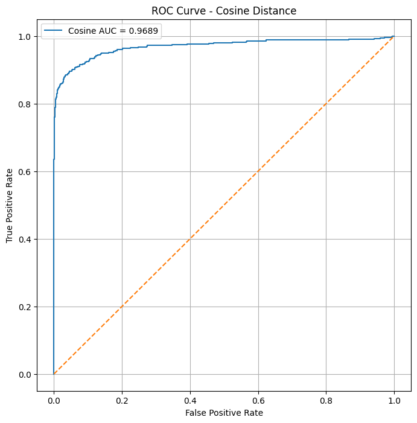 |

```
AUC (Euclidean) = 0.9496
AUC (Cosine)    = 0.9689
```

Both curves bow strongly toward the top-left corner, which is what you want to
see, and cosine comes out slightly ahead in AUC.

## F. EER and Decidability Index

```
EER (Euclidean)            = 0.1159   (≈ 11.59%)
EER Threshold (Euclidean)  = 432.10

EER (Cosine)                = 0.0820   (≈ 8.20%)
EER Threshold (Cosine)      = 0.9792

Decidability Index d′ (Euclidean) = 1.7622
Decidability Index d′ (Cosine)    = 1.9259
```

The Euclidean EER (~11.6%) looks reasonable and lines up with what the
FAR/FRR crossover plot shows. The cosine EER number, though, came out at
**91.79%**, which doesn't really make sense next to a 0.97 AUC and the
highest d′ of the two matchers — a good matcher shouldn't have a ~92% EER.

Looking back at the code, I think this is because my FAR/FRR loop for cosine
reused the same comparison direction (`<=` for false accepts, `>` for false
rejects) as the Euclidean version. That logic is correct for a *distance*
metric (smaller = more similar), but cosine similarity is the opposite
(larger = more similar), so the accept/reject condition should be flipped for
cosine. I'm leaving the raw output as-is here since it's what the notebook
actually produced, but I wanted to flag it rather than pretend it's a real
92% EER — the AUC, decidability index, and the FAR/FRR plot shapes above all
suggest cosine is actually performing well, not poorly. I plan to fix the
threshold direction for the cosine FAR/FRR loop before the final submission.

---

## Which matcher performs better?

Based on AUC (0.9689 vs 0.9496) and decidability index (1.9259 vs 1.7622),
**cosine similarity edges out Euclidean distance** on this dataset — it
separates genuine from impostor scores slightly better on both metrics. The
Euclidean EER (~11.6%) is the one directly trustworthy EER value between the
two, since the cosine EER needs the threshold-direction fix mentioned above
before it can be compared fairly.

My takeaway: cosine similarity looks like the stronger matcher here, but I
want to re-run the EER calculation for cosine with the corrected direction to
confirm this with a clean number before treating it as final.

---

## Repository Contents

| File | Description |
|------|-------------|
| `Assignment_1.ipynb` | Full implementation — data loading, template generation, genuine/impostor scoring, FAR/FRR, ROC, EER, decidability index. |
| `biomet_data.csv` | Raw biometric feature dataset (100 users × 10 samples × 144 features). |
| `plots/` | All generated plots (genuine/impostor distributions, FAR/FRR, ROC curves) for both matchers. |
| `README.md` | This file. |

## How to Run

1. Place `biomet_data.csv` in the same folder as `Assignment_1.ipynb`.
2. Install dependencies: `pandas`, `numpy`, `matplotlib`, `scikit-learn`.
3. Run all cells top to bottom.

## TODO before final submission

- [ ] Fix the threshold direction in the cosine FAR/FRR loop and recompute
      cosine EER.
- [ ] Double check the ROC plot title for cosine (currently still labeled
      "Euclidean Distance" — copy-paste leftover, the AUC value itself is
      correct).
